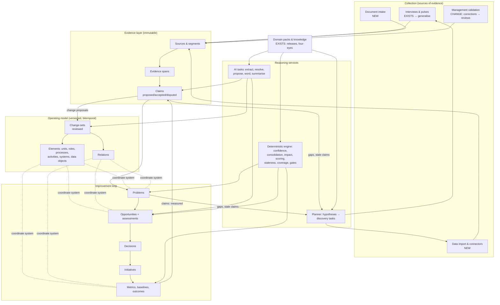
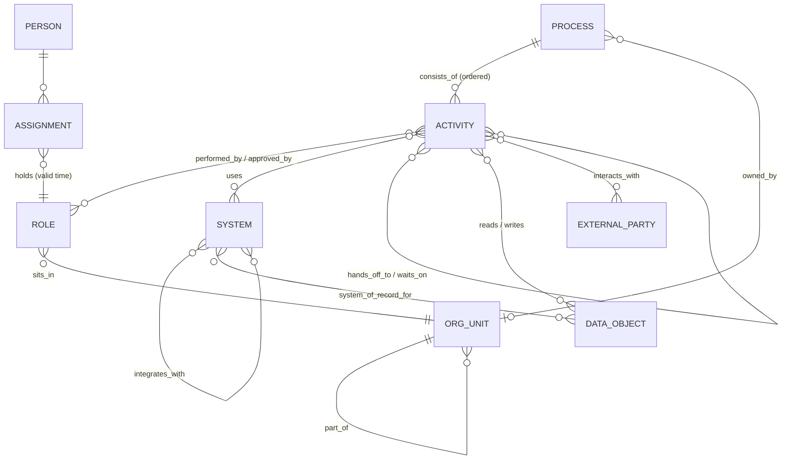

# builda+ — from discovery tool to organisational intelligence

Status: proposal for discussion. No code has been changed.

> **Amended by [design-decisions.md](design-decisions.md)**, which resolves problem identity,
> provenance and contradiction, time, impact measurement and ownership, and lists weak points in
> this document's schema (§8 there). Where the two disagree, design-decisions.md wins.
> This document explains the intended system. Its SQL is illustrative, not executable or
> authoritative. Implementation follows design-decisions.md §10–§12.
Basis: a full read of `builda-plus/` at commit `762608a` — all six migrations, the RLS test, every
module under `src/`, the HTTP layer and the tests. The README was used only to cross-check intent.

Labels used throughout:

- **[EXISTS]** — in the repository today.
- **[CHANGE]** — recommended change to something that exists.
- **[NEW]** — proposed addition, with a stated phase.
- **[LATER]** — deliberately deferred; listed so it is not built early.

---

## 0. The short version

1. The codebase is better than most early AI products in exactly the places that matter for this
   vision: code owns state transitions, AI output is schema-validated and quote-verified, scoring is
   deterministic and explainable, knowledge is versioned with four-eyes review, and tenant isolation
   is enforced by Postgres RLS rather than by application discipline. **Keep all of that.**
2. Its ceiling is structural, not quality-related: **the `discovery` is the root of everything.**
   Evidence, pain points and opportunities all live inside a discovery and die with it. There is no
   organisation-level memory, the "process model" is a hard-coded 14-stage mortgage journey, and
   "evidence" is really an AI-extracted claim stored together with its quote.
3. I do **not** recommend making "the operating model" the single central data structure. The
   centre should be the **evidence chain**: *source → evidence → claim → (model | problem) →
   opportunity → decision → initiative → outcome*. The operating model is the **coordinate system**
   that chain attaches to — necessary, but sparse, and only as detailed as the problems require.
4. Stay on **Postgres, relational, modular monolith**. Represent the model as typed elements plus a
   typed relation table, bitemporally versioned, changed only through reviewed change-sets. Recursive
   CTEs cover the graph queries an organisation of this size needs. No graph database, no event bus,
   no microservices.
5. Biggest product risks in the vision: building a "digital twin" nobody maintains; leading with
   database integrations that mid-market firms won't grant and that yield little; drifting into
   employee surveillance; and generalising across industries before the first vertical works.
6. Migration is incremental: harden → extract the mortgage specifics into a "domain pack" → add the
   model and evidence layers alongside today's tables → re-home problems/opportunities at org level →
   add decisions/outcomes → add data ingestion. Today's discovery flow keeps working at every step.

---

## Stage 1 — Existing architecture assessment

### 1.1 What the system actually does

| Area | Implementation | Files |
|---|---|---|
| Tenancy | Every firm-owned table has `org_id`; RLS `FORCE`d; app role `builda_app` is not owner; per-transaction `set_config('app.current_org_id')`. JADA staff see only assigned discoveries via a `security definer` helper. | `db/001_schema.sql`, `src/db/pool.ts`, `db/test_rls.sql` |
| Interview | Pure state machine (`handleParticipantMessage`). Code picks the next stage (`chooseFocus`); the LLM only (a) interprets an answer into `TurnInterpretation` and (b) words the next question. | `src/interview/orchestrator.ts` |
| Guards | Regex client-data scan **before** any LLM call; hard-keyword escalation; model flags → escalation. Participants are pseudonymised (`P3`); names never reach the model. | `src/guards/*`, `participants.pseudonym` |
| Evidence provenance | Evidence is kept only if `supportingQuote` appears verbatim in the participant's message (`quoteAppearsIn`). Unit conversion is done in code, and assumptions (e.g. 21 working days) are recorded per record. | `orchestrator.ts`, `normaliseEvidence` |
| Persistence | LLM call outside the transaction; save guarded by optimistic `version`; one live session per participant (partial unique index). | `src/interview/service.ts`, `db/002` |
| Analysis | AI proposes key merges and classifications; code validates merges (`applyKeyMerges`), consolidates deterministically (median per participant, ranges kept, disagreements by role, blind spots), and falls back to playbook/human when AI output can't be verified against quotes. | `src/analysis/*` |
| Scoring | Deterministic 6-dimension banded scoring, versioned config, `explainRanking`, exclusion reasons, "unknown in → unknown out" impact maths. | `src/engine/*` |
| Human control | Firm-lead corrections with reasons (append-only `corrections`); `classification_source = 'firm_lead'` is never overwritten by AI. | `analysis/service.ts#correct` |
| Knowledge | Versioned cards/checks/sources; DB-enforced four-eyes (`reviewed_by <> author_id`); immutable releases; each discovery pins a release. Cross-firm candidate mining via `security definer` with a ≥2-firm threshold. | `db/005`, `src/knowledge/*` |
| Outputs | Immutable report snapshots, deterministic report model (no AI), PDF; implementation packs; engineer review with a deterministic two-week feasibility gate. | `src/report/*`, `src/implementation/*` |
| AI plumbing | Vendor-neutral `LLMProvider`, schema-validated with repair retry; `BudgetedProvider` + durable usage ledger per discovery. | `src/llm/*`, `src/db/usageLedger.ts` |
| Audit | Append-only `audit_log` (UPDATE/DELETE revoked); events never contain message text. | `db/001`, `repositories.ts` |

### 1.2 What it does well (and why it matters for the bigger vision)

1. **The control split is correct and enforced in code, not in prompts.** "Code decides, AI
   interprets and words" is precisely principle #3 of the vision. It generalises directly to the
   wider platform.
2. **Provenance is a gate, not a label.** Dropping evidence whose quote can't be found
   (`quoteAppearsIn`) — and re-checking classification quotes — is the single most important
   pattern to carry forward. Most "AI insight" products have no equivalent.
3. **Uncertainty is first-class.** Nulls stay null, ranges and disagreements are preserved,
   confidence describes evidence quality, and assumptions are listed. This is the beginnings of an
   epistemic model.
4. **Database-level tenant isolation** with a tested negative case. This is the correct foundation
   for enterprise customers and must not be weakened when integrations arrive.
5. **Immutable, versioned reference knowledge** with pinning. The same mechanism should become the
   vehicle for industry "domain packs".
6. **Append-only history in several places** (`audit_log`, `corrections`, `analysis_runs`,
   `reports`, `priority_approvals`, `pack_reviews`) — enforced by `REVOKE`, which is cheap and
   effective.
7. **Small and boring tech stack** (Fastify, pg, zod, no ORM). Easy to evolve; nothing to unwind.

### 1.3 Limitations and architectural ceilings

Ordered by how much they block the vision.

**C1 — The discovery is the aggregate root of all knowledge.** `evidence_records`, `pain_points`,
`opportunities`, `analysis_runs`, `reports` are all keyed by `discovery_id`;
`pain_points` is `unique (discovery_id, key)`. A second discovery starts from zero; there is no way to
say "this is the same problem we found in March", to track whether a problem persists, or to
accumulate understanding. This is the main ceiling.

**C2 — Mortgage is in the type system.** `STAGE_IDS`, `ROLES` and `regulatedJudgement` are TypeScript
constants (`src/domain/journey.ts`); `participant_role` and `classification` are **Postgres enums**;
prompts say "UK mortgage firm"; client-data regexes are UK-specific; the playbook card schema
requires a `stageId` from the mortgage enum. Adding a second industry today means a migration plus a
code change in ~15 files.

**C3 — There is no operating model.** The only structure is one linear journey. Departments,
teams, people (beyond per-discovery participants), processes other than "the mortgage journey",
activities within a stage, handoffs and systems do not exist as entities. Systems are free-text
`text[]` on evidence (`"the CRM"`, `"Acre"`, `"our system"` are three different systems).

**C4 — Evidence and interpretation are conflated.** An `evidence_records` row is an
**AI-extracted claim** (pain-point key, stage, task, volume, minutes, cause, improvement) bundled
with its verbatim quote. The quote is evidence; everything else is interpretation. There is no way to
re-extract with a better model, to have two claims cite the same evidence, or to record that
evidence *contradicts* a claim. Also: `VerifiedEvidence.turnIndex` is computed but **not persisted**
(`evidence_records` has no `turn_index` column), and the transcript lives inside the
`interview_sessions.state` JSON blob — so the link from claim back to the exact utterance is lost in
the database.

**C5 — Pain-point identity is unstable.** Keys are invented by the LLM, merges are re-proposed by the
LLM on every `analyse` run, and `analyse` upserts by key without retiring keys that were merged away.
Consequences: (a) a key merged in a later run leaves a **stale `pain_points` row** that is still
scored by `rescore`; (b) a merge accepted in run 1 may not be re-proposed in run 2, splitting a
problem again. Firm-lead corrections hang off a row whose identity can drift.

**C6 — Derived state is overwritten, not versioned.** `pain_points.evidence_summary` is replaced on
every run; `rescore` **deletes and re-inserts all opportunities**, so there is no history of how a
score changed and opportunity ids are not stable. `discoveries.scoring_config_version` is stored but
`rescore` always uses `DEFAULT_SCORING_CONFIG`.

**C7 — Only one evidence channel exists.** `evidence_source` already anticipates
`operational_record` and `measured_baseline`, and `assessConfidence` rewards them — but nothing can
produce them. No document ingestion, no data import, no metrics.

**C8 — No loop closure.** Reports are described as "the baseline for before/after comparison", but
there are no metrics, baselines, measurements or outcome reviews. Decisions are limited to
`priority_approvals`; there is no initiative lifecycle after an implementation pack is confirmed.

**C9 — Long-running work runs inside HTTP requests.** `POST /analyse` performs N LLM calls
synchronously. Fine for 10 pain points; not for re-analysis across an organisation, document
extraction or connector syncs. There is no job mechanism.

**C10 — Identity and access are demo-grade.** Acknowledged in the README, but worth stating
precisely: `src/server.ts` constructs `DevCookieAuth` unconditionally and its constructor throws when
`NODE_ENV=production`, so **there is currently no production start path**. There is one firm role
(`firm_lead`); `org_members.user_id` has no FK; dev cookies reuse the participant token format with
sentinel `discoveryId: 'dev'`. There is no rate limiting.

**C11 — Commercial specifics are in the core.** The two-week feasibility gate, JADA templates
(hard-coded in `src/knowledge/templates.ts`, all `tested: false`), JADA queue and JADA roles are a
delivery-partner offering, modelled as platform core.

**C12 — Privacy edges that will matter more at scale.**
- "By role" de-identification fails for single-person roles (README acknowledges this).
- `knowledge_candidates` exposes `min(pp.title)` across firms to JADA staff at a threshold of two
  firms. Titles fall back to `rs[0].taskDescription` — LLM text derived from a participant's words —
  so firm-specific detail can cross tenants.
- `ai_usage.discovery_id` is `NOT NULL`, so AI work that isn't inside a discovery (e.g. document
  extraction) can't be metered.

### 1.4 Retain / change / remove

| Item | Verdict | Notes |
|---|---|---|
| RLS pattern, `withFirmContext`, non-owner app role, `test_rls.sql` | **Retain** | Extend to every new table; add RLS tests to CI. |
| Orchestrator-as-state-machine, LLM interpret/word only | **Retain** | Generalise "stages" to "model elements in scope". |
| Quote verification, unit conversion in code, recorded assumptions | **Retain** | Becomes the evidence-span verification rule for all sources. |
| `consolidate`, `assessConfidence`, `calculateImpact`, `scoring` | **Retain** | Re-point inputs at claims; make config tenant/pack-versioned. |
| Knowledge items / four-eyes / releases / pinning | **Retain, extend** | Becomes the domain-pack mechanism. |
| Append-only tables via `REVOKE` | **Retain, extend** | Apply to claims, decisions, assessments, model versions. |
| `LLMProvider`, `BudgetedProvider` | **Retain, change** | Meter by org + purpose, not only discovery; log runs for reproducibility. |
| Client-data guard, pseudonyms, escalation | **Retain, change** | Patterns come from the domain pack; add min-group-size rule. |
| `evidence_records` | **Change** | Split into source segments + evidence spans + claims; keep a compatibility view. |
| `pain_points` (discovery-scoped, mutable jsonb summary) | **Change** | Becomes "discovery observation of an org-level problem". |
| `opportunities` delete/reinsert | **Change** | Stable opportunity ids + append-only assessments. |
| Postgres enums `participant_role`, `classification`; stage ids in code | **Change** | Text keys validated against the pinned domain pack. |
| `discoveries.status` free text | **Change** | Explicit state machine in code, transitions audited. |
| Synchronous analysis | **Change** | Postgres-backed job queue, same process or a worker process. |
| `DevCookieAuth` / push-button sign-in | **Remove from production path** | OIDC; keep demo sign-in behind an explicit flag. |
| Hard-coded `TEMPLATES`, two-week gate, JADA queue | **Move** | Into a "delivery partner" module; templates become knowledge items. |

---

## Stage 2 — Product architecture

### 2.1 Challenging the vision first

**"Build a model of how the organisation actually operates."** This is the right *asset* but the
wrong *product*. Enterprise architecture and process-modelling tools have tried to be the
organisation's map for two decades; the recurring failure is that maps nobody needs for a decision
are never maintained, and decay within months. If builda+ sells the model, it inherits that problem.

The better framing: **builda+ is an improvement loop with memory.** Every loop — *notice a problem →
gather evidence → decide → change → measure* — leaves behind verified structure (who does what, in
which system, how often, how long). The model grows where value is being pursued and stays sparse
elsewhere. Coverage is driven by problems and decisions, not by a completeness target.

Concretely, this means:

- Model elements are created when evidence needs somewhere to attach, not by a modelling exercise.
- "Completeness" is never a goal metric; *decision-relevant coverage* is ("for the 5 approved
  opportunities, are the baseline metrics measured?").
- Staleness is managed only for claims that something currently depends on.

**"Connect to enterprise databases and discover metadata."** For the current market (small and
mid-sized regulated firms) this is the lowest-value, highest-cost channel: they run SaaS CRMs and
lender portals, they won't grant database credentials to a young vendor, and schema metadata says
little about where time is lost. What actually produces operational truth is an **event log** (case
id, activity, timestamp, who/what role, which system) — which can be obtained first from a CSV export,
later from APIs. Direct database access is a late, enterprise-only option behind a customer-hosted
agent. See Stage 5.

**"Detect changes in processes and responsibilities."** Be careful with "detect". Without event data
the platform cannot observe change; it can only *ask*. The honest mechanism is (a) time-bound claims
that go stale, (b) short targeted re-validation interviews ("pulses"), and (c) metric drift once data
exists. Promise "keeps understanding current by re-checking what decisions depend on", not
"automatically detects change".

**Continuous monitoring and employee trust.** The current product's strongest trust asset is "this is
about processes, not about you; answers are shared by role". A persistent people model, activity
data from systems, and recurring check-ins are one step from employee monitoring, which carries UK
GDPR / ICO employment-monitoring obligations (lawful basis, DPIA, transparency) and, more importantly,
kills candour in interviews. Design rule: **the platform models roles and work, not individual
performance.** Person-level data exists only for org structure and participation, is held separately,
and never appears in analytics outputs below a minimum group size.

**"Support different industries."** Agree on the architecture (cheap now, expensive later); disagree
on the go-to-market. Make the *core* industry-agnostic now — it costs one domain-pack extraction —
but sell into adjacent regulated, advice-led, case-based businesses (mortgage → protection, wealth/IFA,
general insurance broking, conveyancing, accountancy) before anything horizontal. They share the shape
"case moves through stages, some stages involve regulated judgement, lots of chasing and re-keying",
which is what the playbook and scoring encode. A horizontal "understand any organisation" product
competes with process-mining and EA vendors on their ground.

**The delivery partner (JADA) is part of the product, not a side detail.** The current codebase
assumes an engineering partner picks up approved work. That's a strength (it closes the loop to
action), but it should be modelled generically as a *delivery partner* role with scoped, time-boxed,
audited access — so the platform can support a firm's own team, JADA, or a third party.

### 2.2 Target architecture

A modular monolith on one Postgres database. Modules are folders with explicit interfaces, not
services.



**Modules** (folder per module under `src/`):

| Module | Responsibility | Status |
|---|---|---|
| `tenancy`, `identity` | Orgs, users, memberships, partner access grants, OIDC | CHANGE |
| `packs` (was `knowledge`) | Domain packs: process templates, role templates, cards, checks, sources, metric templates, opportunity patterns, client-data patterns, prompt fragments | CHANGE |
| `model` | Elements, relations, versions, change-sets, as-of queries | NEW |
| `evidence` | Sources, segments, evidence spans, claims, claim review, entity resolution | NEW |
| `discovery` | Engagements (initial, pulse, deep-dive), participants, interviews, follow-ups | CHANGE (from `interview`, `firm`) |
| `ingest` | Document intake, CSV/event-log import, connectors, mappings | NEW |
| `insight` | Problems, consolidation, confidence, hypotheses, coverage/staleness | CHANGE (from `analysis`, `engine`) |
| `improve` | Opportunities, assessments, scoring, decisions, initiatives | CHANGE (from `analysis`, `implementation`) |
| `outcomes` | Metrics, observations, baselines, outcome reviews | NEW |
| `delivery` | Delivery-partner queue, implementation packs, templates, feasibility gates | CHANGE (JADA-specific code moves here) |
| `reporting` | Snapshots, PDFs, playback | EXISTS |
| `ai` | Provider, budget, run log, prompt registry | CHANGE |
| `jobs` | Postgres-backed queue, schedules | NEW |

### 2.3 How information flows

1. **Collect.** An interview turn, an uploaded SOP, or an imported CSV becomes an immutable
   **source** split into **segments** (utterance, paragraph, row batch).
2. **Extract.** An AI task (or a deterministic mapper for structured data) proposes **claims**, each
   citing one or more **evidence spans**. Code verifies the spans (quote present, row exists, offsets
   valid). Unverifiable claims are dropped — today's `quoteAppearsIn` rule, generalised.
3. **Resolve.** Mentions in claims ("the CRM", "case managers") are matched to model elements:
   deterministic exact/alias matching first, AI proposals second, human confirmation for anything
   that creates or merges elements.
4. **Corroborate.** Deterministic rules compute each claim's standing from independent support
   (distinct participants, documents, measurements) and contradictions — today's `assessConfidence`,
   generalised.
5. **Update the model.** Accepted claims that imply structure ("case managers perform document
   chasing in system X") generate **change-set proposals**. Humans accept structural changes; narrow
   rules may auto-accept low-risk corroborated attributes. Accepting writes new element/relation
   versions with valid-time.
6. **Find problems.** Pain/cause claims attach to org-level **problems** anchored on model elements.
   Problem identity persists across engagements.
7. **Propose improvements.** Opportunities come from pack patterns (deterministic match) and AI
   proposals (must cite problems and evidence). Code scores them; scores are appended as assessments.
8. **Decide and act.** Humans record **decisions**; approved opportunities become **initiatives**
   with an owner, a plan (today's implementation pack) and baseline metrics.
9. **Measure.** Metric observations (reported, attested, measured) produce **outcome reviews**,
   which update problem status (resolved / persists / recurred) and feed new claims.
10. **Plan the next question.** The planner turns low-confidence problems, stale claims that
    decisions depend on, and unmeasured baselines into **discovery tasks**: pulse questions,
    validation requests, data requests. Today's `planFollowUps`, generalised.

---

## Stage 3 — Domain and data model

### 3.1 Answers to the modelling questions

**Q1. Core domain model.** Three layers with strict direction of dependency:

1. **Evidence layer** — what was said, written or recorded (immutable).
2. **Knowledge layer** — what we believe about the organisation: claims, and the operating model
   derived from accepted claims (versioned).
3. **Improvement layer** — what we intend to do and what happened: problems, opportunities,
   decisions, initiatives, outcomes (append-only decisions and assessments).

Plus **reference knowledge** (domain packs) that is global, versioned and never contains tenant data.

**Q2. Should the operating model be central?** It should be *shared*, not *central*. Everything
anchors to it, but nothing in it is primary: every element version must be justified by claims or by
an explicit human assertion, and every problem, metric and initiative points at it. If the model were
the centre, the natural failure mode is a big editable diagram whose provenance is "someone typed it".

**Q3. How departments, people, roles, processes, activities and systems relate.**



Design choices:

- **Role, not person, is the unit of work.** Activities are performed by roles. People hold roles
  through time-bounded assignments. This keeps analytics non-personal by construction.
- **Process → Activity, two levels by default.** Activities may nest (`part_of`) when needed, but
  BPMN-level fidelity (gateways, events) is out of scope. Ordering and handoffs are relations, which
  covers 90% of what improvement work needs.
- **Systems are entities with aliases**, so "the CRM", "Acre" and "our case system" resolve to one
  element.
- **External parties** (lenders, solicitors, clients as a class, introducers) matter in case-based
  businesses and are where much of the waiting happens.
- **The mortgage journey becomes a process template** in the mortgage domain pack, instantiated as
  the firm's own process when a discovery starts, then edited by evidence.

**Q4. Evidence, observations, interpretations, hypotheses, problems, opportunities, decisions,
outcomes.** One vocabulary, used consistently:

| Concept | Meaning | Mutable? | Produced by |
|---|---|---|---|
| **Source** | An artefact: interview session, document, data extract, survey | Immutable | Collectors |
| **Segment** | Addressable piece of a source: utterance, paragraph, row range | Immutable | Collectors |
| **Evidence span** | A pointer into a segment (offsets / row ids) with the excerpt and its hash | Immutable | Extractors; verified by code |
| **Claim** (observation) | A typed, structured statement *about the organisation*: "role R performs activity A", "A takes ~20 min", "A happens ~120×/month", "A is slow because of B" | Content immutable; **status** moves through a state machine | AI extraction, connectors (mapped), humans |
| **Interpretation** | Not a separate table: a claim whose `basis = 'ai_inference'` (inferred, not stated) | — | AI |
| **Hypothesis** | A problem or claim with status `hypothesis` that has generated discovery tasks to confirm or refute it | Status changes | AI or humans |
| **Problem** | A persistent, org-level issue anchored on model elements, supported by claims | Status lifecycle; assessments append-only | Consolidation + review |
| **Opportunity** | A proposed intervention against one or more problems, with a pattern/classification | Status lifecycle; assessments append-only | Pack patterns, AI proposals, humans |
| **Decision** | A human, attributable choice about an opportunity, problem, claim or change-set, with rationale | Append-only; superseded by later decisions | Humans only |
| **Initiative** | Approved work being delivered, with owner, plan, baseline | Status lifecycle | Humans |
| **Outcome** | A computed comparison of metric observations against a frozen baseline, plus a human review | Append-only | Deterministic + human |

**Q5. Distinguishing verified facts from AI assumptions.** Replace "verified/unverified" with two
explicit, orthogonal fields on every claim, plus deterministic standing:

- `basis` — *how the statement came to exist*: `stated` (a person said it), `documented`,
  `measured` (computed from system data), `attested` (a manager confirmed it in a review),
  `inferred` (AI reasoning beyond what any source says), `default` (from the domain pack).
- `status` — *where it stands*: `proposed → accepted | disputed | rejected`, later `superseded` or
  `stale`.
- `standing` — *computed, never stored as a free choice*: from independent supporting sources,
  contradictions and basis, using rules like today's `assessConfidence` (two consistent people
  → medium; plus records → high; measured → very high; inferred alone → never above low).

Hard rules, enforced in code and where possible in the database:

1. `inferred` and `default` claims can never be the sole support for a model change, a problem's
   confidence above `low`, or an impact figure. (Today: `assessConfidence` already returns
   `insufficient` for playbook-only/assumption-only evidence — keep that.)
2. A claim with `basis = stated|documented` must have at least one verified evidence span.
3. `attested` is not "true"; it records that an accountable person agreed, and by whom. The UI says
   "confirmed by the operations director on 3 Feb", not "verified".
4. Every number shown to a user carries its basis and, if derived, its assumptions (already done for
   impact; extend everywhere).

**Q6. Evolving over time without losing history.** Bitemporal-lite versioning:

- **Valid time** (`valid_from`, `valid_to`): when it was true *in the organisation*. ("Document
  chasing moved from administrators to case managers in April.")
- **Record time** (`recorded_at`, plus append-only rows): when *builda+ learned* it.
- Model element and relation **versions are append-only**. A change never updates a version; it
  closes the previous one (`valid_to`) and inserts a new one, both via an accepted **change-set**.
- Claims are never edited: a correction is a new claim that `supersedes` the old one (today's
  `corrections` table is the seed of this).
- Assessments (problem confidence, opportunity score) are appended with the config version and an
  input hash, so "why did this rank #1 in June?" is answerable by replay.
- Reports remain immutable snapshots (keep).

"As of" queries are then plain SQL: `where valid_from <= :t and (valid_to is null or valid_to > :t)`
for valid time, `recorded_at <= :t` for what we knew then.

### 3.2 Relational, graph or hybrid?

| Option | For | Against |
|---|---|---|
| **Graph DB** (Neo4j etc.) | Natural for multi-hop traversal ("all activities downstream of system X"), flexible relations | Second datastore to secure, back up and keep consistent; **no RLS equivalent** comparable to Postgres; transactions across stores; team must learn Cypher; temporal versioning is hand-built anyway; graph sizes here are small (hundreds to low thousands of nodes per org) |
| **Pure relational, one table per type** | Strong FKs and constraints, easy reporting | Versioning, provenance and claim-linking must be implemented per table; every new relation kind is a migration; industry variation pushes toward many sparse columns |
| **Hybrid in Postgres** (recommended): typed element table + typed relation table + per-kind attribute validation, all versioned | One versioning mechanism, one provenance mechanism, one RLS pattern; graph traversal via recursive CTEs; relational rigour for everything around it (claims, decisions, metrics) | Attribute validation moves to application (zod per kind, which the codebase already does well); some queries need a join through the relation table |

Recommendation: **Hybrid in Postgres.** The *closed* set of element kinds and relation kinds is
enforced by the database (check constraints + an allowed-relations table); per-kind attributes are
`jsonb` validated by zod schemas from the pinned domain pack. Revisit a graph engine only if a
concrete query pattern (e.g. impact propagation across thousands of activities with interactive
latency) proves CTEs too slow — and even then, consider Apache AGE inside the same Postgres before a
separate store.

Where graph *capabilities* become useful (implemented as CTE queries or in-app traversal):

- Blast radius: "if we change system X, which activities, roles and initiatives are affected?"
- Handoff chains and waiting: "where do cases wait on an external party, end to end?"
- Problem clustering: "which problems share a root system or a handoff?"
- Change impact on claims: "which accepted claims depend on an element that just changed?" (drives
  staleness).
- Visualisation of the process/system map (a UI concern; render from relational data).

### 3.3 Initial relational schema

This is the target shape, written as DDL so trade-offs are concrete. All tenant tables get the
existing RLS pattern (`org_id = app_org() or app_partner_can_access(org_id, ...)`) and `FORCE ROW
LEVEL SECURITY`; append-only tables get `REVOKE UPDATE, DELETE` from `builda_app`. Names are
proposals. Table order is grouped for reading, not for execution (e.g. `change_sets` must be created
before the version tables that reference it); the real migrations in Stage 6 order them correctly.

#### Identity and tenancy [CHANGE]

```sql
-- Global identity (from the IdP). PII kept minimal.
create table users (
  id uuid primary key,
  idp_subject text not null unique,          -- OIDC "sub"
  display_name text not null,
  email text,
  created_at timestamptz not null default now()
);

alter table organisations add column domain_pack text;       -- e.g. 'uk-mortgage'
alter table organisations add column pack_release text;      -- pinned release for the org's model

create table memberships (                                   -- replaces org_members
  org_id uuid not null references organisations(id),
  user_id uuid not null references users(id),
  role text not null check (role in ('owner','admin','analyst','contributor','viewer')),
  primary key (org_id, user_id)
);

-- Generalises jada_assignments: scoped, time-boxed, audited access for a delivery partner.
create table partner_grants (
  id uuid primary key default gen_random_uuid(),
  org_id uuid not null references organisations(id),
  partner_user_id uuid not null references users(id),
  scope text not null check (scope in ('engagement','initiative','org_read')),
  scope_id uuid,                                             -- engagement/initiative id when scoped
  granted_by uuid not null references users(id),
  expires_at timestamptz not null,
  revoked_at timestamptz,
  created_at timestamptz not null default now()
);
```

#### Operating model [NEW, phase 2]

```sql
create table model_elements (
  id uuid primary key default gen_random_uuid(),
  org_id uuid not null references organisations(id),
  kind text not null check (kind in
    ('org_unit','role','process','activity','system','data_object','external_party')),
  key text not null,                                         -- stable slug within org+kind
  template_ref text,                                         -- pack item it was instantiated from
  created_at timestamptz not null default now(),
  unique (org_id, kind, key)
);

create table model_element_versions (                        -- append-only
  id uuid primary key default gen_random_uuid(),
  org_id uuid not null,
  element_id uuid not null references model_elements(id),
  name text not null,
  aliases text[] not null default '{}',
  attrs jsonb not null default '{}',                         -- validated per kind by pack schema
  valid_from date not null,
  valid_to date,                                             -- null = current
  change_set_id uuid not null references change_sets(id),
  recorded_at timestamptz not null default now()
);
create unique index one_current_version on model_element_versions(element_id) where valid_to is null;

create table relation_kinds (                                -- global, closed vocabulary
  kind text primary key,                                     -- performs, uses, part_of, hands_off_to, ...
  from_kind text not null,
  to_kind text not null
);

create table model_relations (                               -- append-only versions of edges
  id uuid primary key default gen_random_uuid(),
  org_id uuid not null,
  kind text not null references relation_kinds(kind),
  from_id uuid not null references model_elements(id),
  to_id uuid not null references model_elements(id),
  attrs jsonb not null default '{}',                         -- e.g. ordinal, share_of_work
  valid_from date not null,
  valid_to date,
  change_set_id uuid not null references change_sets(id),
  recorded_at timestamptz not null default now()
);

create table change_sets (
  id uuid primary key default gen_random_uuid(),
  org_id uuid not null,
  status text not null check (status in ('proposed','accepted','rejected','withdrawn')),
  proposed_by text not null,                                 -- 'user:<id>' | 'ai_run:<id>' | 'import:<id>' | 'pack:<release>'
  summary text not null,
  decided_by uuid references users(id),
  decided_at timestamptz,
  created_at timestamptz not null default now()
);

create table change_set_items (
  id uuid primary key default gen_random_uuid(),
  org_id uuid not null,
  change_set_id uuid not null references change_sets(id),
  op text not null check (op in ('create_element','update_element','retire_element',
                                  'add_relation','end_relation','merge_elements')),
  payload jsonb not null,
  supporting_claims uuid[] not null default '{}'             -- provenance for the model change
);

-- People are kept apart from the model and from analytics.
create table people (
  id uuid primary key default gen_random_uuid(),
  org_id uuid not null references organisations(id),
  user_id uuid references users(id),
  display_name text not null,                                -- never sent to AI
  email text,
  pseudonym text not null,                                   -- stable within the org
  unique (org_id, pseudonym)
);
create table role_assignments (
  id uuid primary key default gen_random_uuid(),
  org_id uuid not null,
  person_id uuid not null references people(id),
  role_element_id uuid not null references model_elements(id),
  valid_from date not null,
  valid_to date
);
```

Why `model_elements` + versions rather than versioning in place: identity (`id`, `key`) is stable for
FKs from problems, metrics and claims, while every change is a new version row carrying the
change-set that justified it.

#### Evidence and claims [NEW, phase 3]

```sql
create table sources (
  id uuid primary key default gen_random_uuid(),
  org_id uuid not null,
  kind text not null check (kind in ('interview','document','data_extract','survey','review','note')),
  title text not null,
  engagement_id uuid,                                        -- discovery/pulse it belongs to, if any
  interview_session_id uuid references interview_sessions(id),
  connector_run_id uuid,
  content_hash text,                                         -- for documents/extracts
  storage_ref text,                                          -- object storage key, encrypted at rest
  sensitivity text not null default 'internal',
  captured_at timestamptz not null,
  retain_until date,
  created_at timestamptz not null default now()
);

create table source_segments (                               -- append-only
  id uuid primary key default gen_random_uuid(),
  org_id uuid not null,
  source_id uuid not null references sources(id),
  ordinal int not null,                                      -- turn index / paragraph / row batch
  speaker text,                                              -- 'participant:P3' | 'interviewer' | null
  text_redacted text,                                        -- what the AI may see
  locator jsonb not null default '{}',                       -- page, heading path, row range
  created_at timestamptz not null default now(),
  unique (source_id, ordinal)
);

create table evidence_spans (                                -- append-only
  id uuid primary key default gen_random_uuid(),
  org_id uuid not null,
  segment_id uuid not null references source_segments(id),
  start_offset int, end_offset int,                          -- character span when textual
  excerpt text not null,
  verified boolean not null,                                 -- code checked excerpt ⊂ segment
  created_at timestamptz not null default now()
);

create table claims (
  id uuid primary key default gen_random_uuid(),
  org_id uuid not null,
  claim_type text not null,                                  -- performs, uses_system, volume, duration,
                                                             -- pain, cause, handoff, wait, rule, workaround ...
  subject_element_id uuid references model_elements(id),    -- null until resolved
  subject_mention text,                                      -- raw text when unresolved ("the CRM")
  object_element_id uuid references model_elements(id),
  value jsonb not null default '{}',                         -- typed by claim_type (zod), canonical units
  value_as_stated jsonb,                                     -- participant's own units, for audit
  conversion_assumptions text[] not null default '{}',
  basis text not null check (basis in ('stated','documented','measured','attested','inferred','default')),
  asserted_by text not null,                                 -- 'participant:P3' | 'user:<id>' | 'import:<id>' | 'pack:<rel>'
  extracted_by_run uuid,                                     -- ai_runs.id when AI extracted it
  valid_during daterange,                                    -- when the claim is about
  status text not null default 'proposed'
    check (status in ('proposed','accepted','disputed','rejected','superseded','stale')),
  supersedes uuid references claims(id),
  engagement_id uuid,
  created_at timestamptz not null default now()
);

create table claim_evidence (
  claim_id uuid not null references claims(id),
  span_id uuid not null references evidence_spans(id),
  relation text not null check (relation in ('supports','contradicts')),
  primary key (claim_id, span_id)
);

create table claim_status_events (                           -- append-only; status changes go through code
  id bigserial primary key,
  org_id uuid not null,
  claim_id uuid not null references claims(id),
  from_status text, to_status text not null,
  actor text not null, reason text,
  created_at timestamptz not null default now()
);
```

The current `evidence_records` maps cleanly: interview transcript turns → `source_segments`;
`supporting_quote` → `evidence_spans`; each record → 2–6 claims (`pain`, `performs`, `volume`,
`duration`, `uses_system`, `cause`) sharing that span.

#### Problems, opportunities, decisions [NEW/CHANGE, phase 4–5]

```sql
create table problems (
  id uuid primary key default gen_random_uuid(),
  org_id uuid not null,
  key text not null,                                         -- stable; pack key when one fits
  title text not null,
  status text not null check (status in
    ('hypothesis','open','being_addressed','resolved','recurred','dismissed')),
  first_seen_at timestamptz not null,
  created_at timestamptz not null default now(),
  unique (org_id, key)
);
create table problem_anchors (problem_id uuid references problems(id), element_id uuid references model_elements(id),
                              primary key (problem_id, element_id));
create table problem_claims  (problem_id uuid references problems(id), claim_id uuid references claims(id),
                              primary key (problem_id, claim_id));
create table problem_merges (                                -- explicit, reviewed identity changes
  id uuid primary key default gen_random_uuid(), org_id uuid not null,
  survivor_id uuid not null references problems(id), merged_id uuid not null references problems(id),
  proposed_by text not null, decided_by uuid, reason text, created_at timestamptz not null default now()
);
create table problem_assessments (                           -- append-only, replayable
  id uuid primary key default gen_random_uuid(), org_id uuid not null,
  problem_id uuid not null references problems(id),
  confidence text not null, confidence_detail jsonb not null,
  volume jsonb, duration jsonb,                              -- {value,min,max,n,basis}
  rules_version text not null, inputs_hash text not null,
  computed_at timestamptz not null default now()
);

create table opportunities (                                 -- stable ids; never delete/reinsert
  id uuid primary key default gen_random_uuid(),
  org_id uuid not null,
  title text not null,
  approach text not null,                                    -- pack vocabulary: fix, automate, overhaul, keep_human, ...
  pattern_ref text,                                          -- pack opportunity pattern / template
  status text not null check (status in
    ('proposed','shortlisted','approved','rejected','deferred','in_delivery','delivered','abandoned')),
  proposed_by text not null,
  created_at timestamptz not null default now()
);
create table opportunity_problems (opportunity_id uuid references opportunities(id), problem_id uuid references problems(id),
                                   primary key (opportunity_id, problem_id));
create table opportunity_assessments (                       -- append-only (replaces score columns)
  id uuid primary key default gen_random_uuid(), org_id uuid not null,
  opportunity_id uuid not null references opportunities(id),
  impact jsonb not null, score numeric, rank int, breakdown jsonb, explanation jsonb,
  assumptions jsonb not null, excluded_reason text,
  scoring_config_version text not null, inputs_hash text not null,
  computed_at timestamptz not null default now()
);

create table decisions (                                     -- append-only, humans only
  id uuid primary key default gen_random_uuid(), org_id uuid not null,
  subject_type text not null check (subject_type in ('opportunity','problem','change_set','claim','initiative')),
  subject_id uuid not null,
  decision text not null,                                    -- approve, reject, defer, accept_risk, close ...
  rationale text not null,
  context jsonb not null default '{}',                       -- e.g. ranked list the decision was made from
  decided_by uuid not null references users(id),
  supersedes uuid references decisions(id),
  created_at timestamptz not null default now()
);

create table initiatives (
  id uuid primary key default gen_random_uuid(), org_id uuid not null,
  opportunity_id uuid not null references opportunities(id),
  owner_user_id uuid references users(id),
  status text not null check (status in ('planned','in_progress','live','evaluating','closed','abandoned')),
  plan jsonb,                                                -- today's implementation pack lives here
  target_change_set uuid references change_sets(id),         -- the "to-be" model change
  created_at timestamptz not null default now()
);
```

#### Metrics and outcomes [NEW, phase 5]

```sql
create table metrics (
  id uuid primary key default gen_random_uuid(), org_id uuid not null,
  element_id uuid not null references model_elements(id),    -- usually an activity or process
  key text not null, name text not null,
  unit text not null,                                        -- minutes, count/month, days, %
  template_ref text,                                         -- pack metric template
  unique (org_id, key)
);
create table metric_observations (                           -- append-only
  id uuid primary key default gen_random_uuid(), org_id uuid not null,
  metric_id uuid not null references metrics(id),
  period daterange not null,
  value numeric not null,
  basis text not null check (basis in ('measured','reported','attested','estimated')),
  claim_id uuid references claims(id),                       -- provenance
  created_at timestamptz not null default now()
);
create table baselines (                                     -- frozen at initiative start
  id uuid primary key default gen_random_uuid(), org_id uuid not null,
  initiative_id uuid not null references initiatives(id),
  metric_id uuid not null references metrics(id),
  observation_ids uuid[] not null,
  value numeric not null, basis text not null,
  frozen_at timestamptz not null default now()
);
create table outcome_reviews (                               -- append-only
  id uuid primary key default gen_random_uuid(), org_id uuid not null,
  initiative_id uuid not null references initiatives(id),
  computed jsonb not null,                                   -- per metric: baseline, after, delta, basis, n
  confounders text,                                          -- human note: other changes in the period
  verdict text check (verdict in ('improved','no_change','worse','inconclusive')),
  reviewed_by uuid references users(id),
  created_at timestamptz not null default now()
);
```

#### Engagements, AI runs, jobs [CHANGE/NEW]

```sql
-- discoveries → engagements (rename by view first; see Stage 6)
alter table discoveries add column kind text not null default 'initial'
  check (kind in ('initial','pulse','deep_dive','validation'));
alter table discoveries add column scope_element_ids uuid[] not null default '{}';

create table discovery_tasks (                               -- generalises follow_ups
  id uuid primary key default gen_random_uuid(), org_id uuid not null,
  reason text not null check (reason in ('disagreement','missing_measurement','stale_claim',
                                         'hypothesis','coverage_gap','baseline_needed')),
  target_problem_id uuid, target_claim_id uuid, target_element_id uuid,
  channel text not null check (channel in ('interview','validation','data_request')),
  question text,                                             -- code-written where possible
  status text not null default 'open' check (status in ('open','assigned','answered','cancelled')),
  created_at timestamptz not null default now()
);

create table ai_runs (                                       -- replaces ai_usage; reproducibility + metering
  id uuid primary key default gen_random_uuid(), org_id uuid not null,
  purpose text not null,                                     -- interview.interpret, evidence.extract, ...
  engagement_id uuid,
  model text not null, prompt_version text not null,
  input_hash text not null,
  output jsonb,                                              -- validated output (no raw PII)
  outcome text not null check (outcome in ('accepted','schema_failed','verification_failed','error')),
  input_tokens int not null, output_tokens int not null,
  created_at timestamptz not null default now()
);

create table jobs (                                          -- simple SKIP LOCKED queue
  id bigserial primary key, org_id uuid,
  kind text not null, payload jsonb not null,
  run_after timestamptz not null default now(),
  attempts int not null default 0, locked_at timestamptz, locked_by text,
  done_at timestamptz, last_error text
);
```

What is intentionally **not** in the schema: a generic triple store, user-defined element kinds,
per-tenant custom fields, BPMN gateways, embeddings. Each can be added later when a concrete need
appears.

---

## Stage 4 — Intelligence architecture

### 4.1 Principle: AI proposes, code disposes

The existing split generalises into one rule: **AI output is always a proposal with a target state
of `proposed`. Only deterministic code or an identified human moves anything out of `proposed`.**

| AI does | AI never does |
|---|---|
| Extract claims from text, with evidence spans | Set claim status, confidence or standing |
| Propose entity resolutions and merges | Merge elements or problems without rule/human acceptance |
| Propose model change-sets | Accept change-sets |
| Word interview and validation questions | Choose what to ask next (planner does) |
| Propose hypotheses and opportunities (citing problems/evidence) | Score, rank or prioritise |
| Summarise and narrate (playback, report prose) with citations | Compute any figure shown to users |
| Map imported activity names to model activities (proposal) | Write metric observations |

Every AI call is recorded in `ai_runs` with purpose, model, prompt version and input hash, so any
proposal can be traced to the run that made it and re-run with a different model.

### 4.2 Components and how they cooperate

**1. Discovery (collection).** Generalise the orchestrator from "stages of the mortgage journey" to
"model elements in scope":

- Scope = a set of processes/activities (from the pack template on first discovery; from the planner
  afterwards).
- Coverage rules stay deterministic (`evidenceToCoverStage`, `maxQuestionsPerStage` become
  per-element and per-claim-type: "for each in-scope activity, aim for performer + volume + duration
  + systems").
- Pulses: 5-minute interviews generated entirely from `discovery_tasks` (today's follow-up mode,
  which already uses code-written questions and no model call for choosing the question).
- Management validation becomes a structured review UI over *claims and change-sets* rather than
  a correction form on pain points. Each accept/reject is a decision with a reason.

**2. Extraction.** One pipeline for all text sources: segment → AI extracts typed claims with span
offsets → code verifies spans (generalised `quoteAppearsIn`, plus offset checks for documents) →
code normalises units and records assumptions (today's `normaliseEvidence`) → claims stored as
`proposed`.

**3. Reconciliation.** Deterministic first, AI second, human last:

- Exact key/alias matching to elements and problems.
- AI proposes matches for the remainder, with reasons (today's `proposeKeyMerges`).
- Code validates proposals (today's `applyKeyMerges` rules: no double-use, never merge two pack
  keys, pack key wins) and **persists accepted merges** in `problem_merges` / change-sets so identity
  is stable across runs. This fixes C5.

**4. Evidence validation and standing.** Deterministic rules per claim type, versioned
(`rules_version`), generalising `assessConfidence`:

- Independence: two claims from the same participant are one source; a document authored by the
  same team is weaker than a system measurement.
- Consistency: numeric claims compared with `CONSISTENCY_RATIO`; categorical claims compared for
  contradiction.
- Basis ceiling: `inferred`/`default` cap standing at `low`.
- Disagreements are preserved and surfaced by role (existing behaviour), subject to the
  minimum-group-size rule.

**5. Organisational memory.** The memory *is* the evidence + claims + versioned model; no separate
"memory store". For question-answering ("why do we chase documents so much?"), retrieval is SQL over
claims anchored on the relevant elements, then the AI writes an answer that must cite claim ids;
code verifies every citation exists and is accessible to the asker. Add `pgvector` for semantic
retrieval over segments **[LATER]**, only when keyword/element-anchored retrieval proves
insufficient.

**6. Problem identification.** Problems are formed by consolidation (today's `consolidate`, keyed by
stable problem ids) and assessed deterministically into `problem_assessments`. Additional
rule-based detectors **[NEW, phase 6+]** once data exists: rework loops, long waits on external
parties, the same data typed into two systems (from `uses_system` + `writes` claims), single-person
dependency (an activity performed by one role-holder with no backup).

**7. Opportunity identification.** Three channels, one scoring path:

1. Pack patterns matched deterministically to problems (today: card `likelyClassification` +
   template lookup).
2. AI proposals, which must cite ≥1 problem and evidence spans, and pass the same quote verification
   as `classifyPainPoint`.
3. Human-entered opportunities.

All are scored by the existing engine, appended to `opportunity_assessments` with config version and
input hash. "Keep human" and "insufficient evidence" exclusions remain.

**8. Monitoring and staleness.** Deterministic, schedule-driven (a `jobs` cron):

- Each claim type has a freshness window in the pack (e.g. volumes 6 months, `performs` 12 months).
- A claim becomes `stale` only if something depends on it: an open problem, an approved opportunity,
  an initiative baseline. Unreferenced claims age silently.
- Stale-but-relevant claims, low-confidence problems, and initiatives past go-live without a
  post-measurement generate `discovery_tasks`.
- Outcome reviews update problem status: `resolved` (metric improved and attested), `recurred`
  (new pain claims after resolution), `persists`.

**9. The planner.** The connective tissue: it turns gaps into questions. Inputs: coverage gaps,
disagreements, missing measurements, hypotheses, stale dependencies, baselines needed. Output:
prioritised `discovery_tasks` grouped per person/role, respecting limits (today's
`maxPerParticipant`) and fatigue rules (no more than one pulse per person per N weeks). Entirely
deterministic; AI only words questions where a code template doesn't fit.

### 4.3 Privacy and trust controls in the intelligence layer

- **Minimum group size (k)** for any role-attributed output (quotes, figures, disagreements):
  if a role has fewer than k participants (k configurable, default 3), aggregate up to the org unit
  or show "a team member". Enforced in the playback/report builders, not in the UI.
- **No person-level analytics.** Metrics attach to activities and processes; connectors pseudonymise
  user identifiers and the platform never ranks people.
- **Cross-tenant learning** (pack improvement): only from canonical pack keys and counts, never free
  text; threshold raised to ≥5 firms; reviewed by knowledge staff before anything enters a release.
- **Client-data guard** patterns move into the domain pack, plus the planned model-based second
  check, applied to *every* text source (documents and imports too), before AI sees it.

---

## Stage 5 — Integration architecture

### 5.1 Ladder of integration, in order of value per unit of effort

| Tier | What | Why first/later | Phase |
|---|---|---|---|
| 0 | **Document intake**: SOPs, procedure manuals, org charts, job descriptions, system lists (PDF, DOCX, MD) | Cheap, no security review, immediately produces `documented` claims that corroborate interviews | 6 |
| 1 | **Structured file import**: CSV/XLSX exports of case pipelines, task lists, status histories → **event log** | Produces `measured` volumes and durations — the evidence the confidence model already rewards most. Customers can export without granting access | 6 |
| 2 | **Read-only SaaS API connectors** for the 2–3 systems that dominate the first vertical (case management/CRM, task/workflow tool) | Repeats tier 1 automatically; enables monitoring and outcome measurement | 7 |
| 3 | **Collaboration metadata** (ticket queues, shared-mailbox volumes — counts and timestamps only, never content) | Measures chasing and status-update load, which interviews only estimate | LATER |
| 4 | **Direct database access** via a customer-hosted agent against a read replica | Only for enterprise customers with their own data teams; high security cost | LATER |

What I'd explicitly avoid: crawling schemas for "metadata discovery" as a product feature,
desktop/screen activity capture (task mining) — high surveillance risk and poor fit with the trust
model — and any write access to customer systems from the platform core. (Automation that writes to
customer systems belongs to initiatives delivered by a partner, outside the platform's trust
boundary.)

### 5.2 Canonical ingestion pipeline

```mermaid
flowchart LR
  A[Connector / upload] --> B[Raw extract<br/>immutable source, hashed,<br/>encrypted, retention set]
  B --> C[Guard: client-data scan,<br/>pseudonymise ids with<br/>per-tenant HMAC key]
  C --> D[Mapper<br/>declarative, versioned,<br/>per connector]
  D --> E[Normalised event log<br/>case_ref, activity_label,<br/>ts, role, system, attrs]
  E --> F[Activity mapping<br/>AI proposes label→activity,<br/>human confirms once]
  F --> G[Deterministic metrics<br/>volume, cycle time, waits,<br/>rework, handoffs]
  G --> H[Claims basis=measured<br/>+ metric_observations]
```



Key decisions:

- **Store the minimal normalised event log, not customer data.** Case references are HMAC-hashed with
  a per-tenant key at the boundary; free-text fields are dropped unless explicitly mapped and scanned.
  This keeps the existing "no client data" promise intact while adding operational truth.
- **Mappings are configuration, not code**: `connector_mappings(org_id, connector, version,
  spec jsonb)` with change review. Activity-label→activity mappings are AI-proposed once and then
  deterministic.
- **Metrics are computed by code** from the event log (counts per period, durations between
  activities, wait time between handoffs, loops). The AI never computes a metric.
- **Each import run is a source** with a `connector_run_id`, so every measured claim traces back to a
  run, a mapping version and a file hash.

Minimal tables **[NEW, phase 6]**:

```sql
create table connectors (id uuid primary key, org_id uuid not null, kind text not null,
  config jsonb not null, secret_ref text, status text not null, created_at timestamptz default now());
create table connector_runs (id uuid primary key, org_id uuid not null, connector_id uuid,
  mapping_version int not null, started_at timestamptz, finished_at timestamptz,
  rows_in int, rows_kept int, outcome text, source_id uuid references sources(id));
create table events (                       -- partition by org_id/month when volume demands it
  org_id uuid not null, run_id uuid not null, case_ref text not null,   -- HMAC'd
  activity_element_id uuid, activity_label text not null, occurred_at timestamptz not null,
  role_element_id uuid, system_element_id uuid, attrs jsonb not null default '{}');
create table activity_label_mappings (org_id uuid not null, connector_kind text not null,
  label text not null, activity_element_id uuid not null, decided_by uuid not null,
  primary key (org_id, connector_kind, label));
```

### 5.3 Security for integrations

- Read-only, least-privilege OAuth scopes; secrets in a managed secret store referenced by
  `secret_ref`, never in Postgres.
- Connector code runs in the job worker with the tenant's RLS context (`withFirmContext`) — never as
  a superuser, never cross-tenant.
- Per-tenant encryption key for raw extracts in object storage; retention enforced by job.
- Customer-visible connector audit: what was pulled, when, how many rows kept/dropped.
- Tier 4 only through an agent the customer hosts, which pushes normalised events outbound; builda+
  never holds database credentials.

### 5.4 Workflow and documentation platforms

- Treat ticketing/workflow tools as **event sources** (tier 2/3), not as places builda+ writes to.
- Push *outputs* outward where useful: initiatives as tickets in the customer's tool, reports as PDFs
  (exists), read-only API for BI. Outbound pushes are human-triggered and audited.
- Documentation platforms (wikis, SharePoint) are tier-0 sources via export or read-only API;
  re-ingesting a changed page creates a new source version and marks dependent `documented` claims for
  re-check.

---

## Stage 6 — Migration strategy

Guiding rule: **add alongside, backfill, switch readers, then retire.** The current discovery flow
must keep working after every phase, guarded by the existing test suite plus new RLS and backfill
tests. Migrations continue the `db/NNN_*.sql` sequence.

### Phase 0 — Hardening before anything new (≈2–3 weeks)

Production-blocking and cheap; does not depend on the vision.

| Change | Detail |
|---|---|
| Production auth | OIDC adapter implementing `FirmLeadAuth`/`JadaAuth`; `server.ts` picks dev auth only when `DEMO_SIGNIN=1` and not production. `users` + `memberships` (migration `007`). |
| Persist turn index | `alter table evidence_records add column turn_index int` and write it — cheap now, required for backfill later. |
| Stale pain points | `analyse` marks pain points whose key no longer appears as `superseded` (new column) and `rescore` skips them; persist accepted merges and re-apply them instead of re-proposing every run. |
| Scoring config | Load config by `discoveries.scoring_config_version` from a `scoring_configs` table; stop ignoring the stored version. |
| Jobs | `jobs` table + worker loop (`SELECT … FOR UPDATE SKIP LOCKED`); move `analyse` and `sendFollowUps` to jobs; HTTP returns 202 + status. |
| Discovery state machine | Explicit transitions in code (`draft → profile → interviews → analysed → priorities_approved → closed`) with audit. |
| Rate limiting | `@fastify/rate-limit` on participant and auth routes. |
| Min-group-size rule | Implement in `playback`/`buildReportModel` (closes the README's open product decision with a default). |
| `knowledge_candidates` | Return keys and counts only; threshold ≥5. |

### Phase 1 — Extract the domain pack (≈3 weeks)

Goal: no mortgage-specific constant in core code. Behaviour unchanged.

- Add knowledge item kinds: `process_template`, `role_template`, `classification_vocab`,
  `client_data_patterns`, `prompt_fragment`, `metric_template`, `opportunity_pattern` (templates move
  out of `src/knowledge/templates.ts`).
- Ship `uk-mortgage` as the first pack release, generated from today's `STAGES`, `ROLES`,
  `DEFAULT_STAGES_BY_ROLE`, prompts, regexes and templates.
- Migration `008`: convert `participant_role`, `classification` enums to `text`; validate in code
  against the pinned pack. (`alter type … ` → `alter column … type text using …::text`.)
- `journey.ts` becomes a loader over the pack; `StageIdSchema` becomes a runtime schema built from
  the pinned release.
- Tests: snapshot that the pack-driven orchestrator and analysis produce identical outputs to today
  on the existing fixtures.

### Phase 2 — Operating model alongside (≈4 weeks)

- Migration `009`: `model_elements`, `model_element_versions`, `model_relations`, `relation_kinds`,
  `change_sets`, `change_set_items`, `people`, `role_assignments`, RLS + append-only grants.
- Creating a discovery instantiates the pack's process template as a change-set
  (`proposed_by = 'pack:<release>'`), accepted by the firm lead in one click: elements for the
  process, its activities (today's stages), roles, and systems from the firm profile.
- Backfill job: for each existing discovery, instantiate the same; map `stage_id` →
  activity element; `participants` → `people` (pseudonym preserved) + `role_assignments`;
  `firm_profile.systems` and distinct `evidence_records.systems` → system elements with aliases
  (AI-proposed alias clusters, human-confirmed).
- Add nullable `activity_element_id` to `evidence_records` and `pain_points`, backfilled.
- UI: a read-only "how we work" view (process → activities → roles/systems).

### Phase 3 — Evidence layer (≈4 weeks)

- Migration `010`: `sources`, `source_segments`, `evidence_spans`, `claims`, `claim_evidence`,
  `claim_status_events`, `ai_runs`.
- Interview service writes segments for every turn (today they live only in `state.transcript`), and
  writes claims instead of `evidence_records`. The orchestrator's `InterviewState.evidence` keeps
  driving coverage, unchanged.
- Backfill: transcript turns → segments; each `evidence_records` row → a span + claims; `corrections`
  → superseding claims with `basis = 'attested'`.
- Replace the `evidence_records` table with a **compatibility view** over claims so `loadEvidence`,
  `consolidate` and tests keep working; then move `loadEvidence` to read claims directly and drop the
  view.
- `ai_usage` → `ai_runs` (view for the budget ledger during transition); budget keyed by org +
  purpose with per-engagement caps retained.

### Phase 4 — Org-level problems and stable opportunities (≈3–4 weeks)

- Migration `011`: `problems`, `problem_anchors`, `problem_claims`, `problem_merges`,
  `problem_assessments`, new `opportunities` shape, `opportunity_problems`,
  `opportunity_assessments`.
- Backfill: group `pain_points` across discoveries by `(org_id, key)` (post-merge) → problems;
  existing pain points become per-discovery views of a problem (`pain_points.problem_id`).
- `rescore` appends assessments instead of delete/reinsert; opportunity ids become stable.
- Playback and report builders read problems + latest assessments; output is checked against
  today's report fixtures.
- First visible new capability: **"since last time"** — a second discovery shows which problems
  persist, improved, or are new.

### Phase 5 — Decisions, initiatives, outcomes (≈4 weeks)

- Migration `012`: `decisions`, `initiatives`, `metrics`, `metric_observations`, `baselines`,
  `outcome_reviews`, `discovery_tasks` (absorbing `follow_ups`).
- `priority_approvals` → decisions (backfill; keep table read-only); `implementation_packs` →
  `initiatives.plan`; `pack_reviews` → decisions on the initiative. The two-week feasibility gate and
  partner queue move into `src/delivery/`.
- Baselines are frozen from problem assessments when an initiative starts (`basis` carried through —
  most will be `reported`, which is honest).
- Pulse engagements for post-change measurement (reported figures), until data imports exist.

### Phase 6 — Ingestion tiers 0–1 (≈4–6 weeks)

- Document intake: upload, client-data scan, segmenting, extraction into `documented` claims.
- CSV/XLSX event-log import with a mapping UI, label→activity mapping, deterministic metrics,
  `measured` claims and observations.
- Staleness rules and the planner scheduling (cron job).

### Phase 7 — Connectors and continuous mode

- 1–2 API connectors chosen by what pilot customers actually run, not by breadth.
- Outcome reviews driven by measured data; problem lifecycle automation (resolved/recurred
  suggestions, human-confirmed).

### LATER (only with a demonstrated need)

pgvector retrieval; graph visualisation beyond process maps; second industry pack; tier 3–4
integrations; customer-defined element kinds; any form of separate service or datastore.

### Deprecations summary

| Component | Replaced by | Removal |
|---|---|---|
| `DevCookieAuth` in production path, `signin_directory` | OIDC + memberships | Phase 0 (demo flag only) |
| `org_members`, `app_users`, `jada_assignments`, `jada_staff_roles` | `users`, `memberships`, `partner_grants`, platform staff roles | Phase 0–1 (views during transition) |
| Postgres enums `participant_role`, `classification` | text validated by pack | Phase 1 |
| `src/domain/journey.ts` constants, `src/knowledge/templates.ts` | Domain pack release | Phase 1 |
| `evidence_records` | segments + spans + claims (view in between) | Phase 3 |
| `ai_usage` | `ai_runs` | Phase 3 |
| `pain_points` as source of truth | `problems` (+ per-discovery view) | Phase 4 |
| opportunity delete/reinsert | `opportunity_assessments` | Phase 4 |
| `follow_ups`, `priority_approvals`, `implementation_packs`, `pack_reviews` | `discovery_tasks`, `decisions`, `initiatives` | Phase 5 (read-only, then archived) |

---

## Appendix A — Answers to the ten questions, briefly

1. **Core domain model:** evidence → claims → (operating model | problems) → opportunities →
   decisions → initiatives → outcomes, with domain packs as global reference knowledge.
2. **Operating model central?** Shared coordinate system, not the centre. Grown by evidence and
   decisions, sparse by design.
3. **Relationships:** roles perform activities; people hold roles over time; activities belong to
   processes, use systems, hand off to each other, touch data objects and external parties; org units
   own processes and contain roles.
4. **Representation:** separate immutable evidence from typed claims; hypotheses are claims/problems
   in a status that spawns discovery tasks; decisions are append-only human records.
5. **Facts vs AI assumptions:** explicit `basis` + `status` per claim, computed `standing`; AI basis
   capped; numbers always show basis and assumptions; "attested" ≠ "true".
6. **Evolving without losing history:** append-only versions with valid time and record time,
   change-sets, superseding claims, replayable assessments, immutable reports.
7. **Enterprise systems:** documents and exports first, read-only APIs second, customer-hosted agent
   for databases last; normalised, pseudonymised event log; code computes metrics.
8. **Beyond AI discovery:** the opportunity vocabulary already includes fix/overhaul/keep_human; add
   patterns for standardise, eliminate, train, reassign; problems persist and outcomes are measured,
   which is general operational improvement.
9. **Relational vs graph:** hybrid in Postgres — typed elements and relations with versioning and
   RLS; recursive CTEs for traversal; no separate graph store unless measured need.
10. **AI's role:** proposer, extractor, resolver-candidate, question-writer and narrator, with every
    output in `proposed` state, logged in `ai_runs`, and promoted only by deterministic rules or
    identified humans.

## Appendix B — Open questions that need a product owner

1. Who is the buyer after the first vertical: firm owner, operations lead, or a network/principal
   firm overseeing many appointed representatives? (The last is an interesting multi-org shape the
   tenancy model should allow: one parent org with read access across child orgs.)
2. Is the delivery partner exclusive (JADA) or open? This determines how much of `delivery/` is
   product.
3. Minimum group size (k) default and whether firms may lower it.
4. Retention defaults per source kind (interviews vs documents vs event logs).
5. Which two systems to build the first connectors for — decide from pilot customers' stacks.
